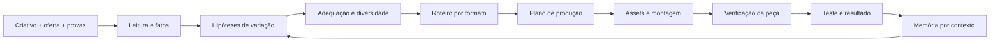

# Motor de variação semântica: proposta para a próxima implementação

**Resultado desejado:** receber um criativo e a oferta, entender a função de cada argumento e produzir versões com intenção de teste explícita. A máquina precisa lembrar o que aprendeu sobre a oferta e o público, além de armazenar MP4s.

Este documento não altera os contratos vigentes nem prova capacidade de um provedor. É uma proposta construída a partir da [pesquisa](README.md), pronta para discussão e detalhamento técnico.

## 1. Entradas necessárias

- Criativo de origem: vídeo, imagem, copy, transcrição e observações multimodais disponíveis.
- Oferta: produto, preço, CTA, mecanismo real, elegibilidade, benefícios e fatos aprovados.
- Provas: demonstrações, reviews autorizados, resultados com condições e fonte, capturas atuais.
- Público: compradores observados, situações de uso, dores, desejos, objeções e linguagem.
- Resultado do criativo: quando houver, separar gasto, CPA, receita, qualidade e janela; upload sozinho não comprova que é campeão.
- Intenção: melhorar uma peça, transpor formato, explorar mensagem, abrir hipótese de público ou localizar.
- Restrições de produção: ativos disponíveis, identidade autorizada, língua e teto de custo definido para o job.

Quando faltar prova, o motor pode gerar explicação ou plano com pendência. Não preenche a lacuna inventando depoimento, estudo, personagem real ou resultado.

## 2. Representação intermediária proposta

| Objeto | Conteúdo mínimo | Por que existe |
|---|---|---|
| CreativeSource | ID do asset, origem, direitos, transcrição/observações, data | Rastrear de onde veio |
| CreativeDNA | tese, problema, promessa, mecanismo, prova, objeção, CTA, beats | Preservar a função do anúncio |
| OfferFact | afirmação, fonte, condições, status de verificação | Impedir deriva factual |
| AudienceHypothesis | contexto, job, dor, desejo, objeção, fonte, adequação à oferta | Evitar persona inventada por demografia |
| VariationBrief | operação, eixos alterados, constantes, hipótese, formato, evidências | Explicar por que produzir |
| ScriptPlan | beats, falas, personagem, visual, prova, CTA | Transformar a tese em cenas |
| ProductionPlan | ativos reutilizados, gerados e faltantes, dependências e custo | Evitar gerar vídeo caro antes de decidir a peça |
| ExperimentRecord | controle, KPI, amostra, período, atribuição e resultado | Aprender sem confundir correlação com causa |
| Learning | conclusão contextual, confiança, evidência e validade temporal | Alimentar a próxima rodada |

Todos os nomes acima são conceituais; não são tabelas ou tipos existentes. Antes de implementar, mapear sobre Champion, VariationBatch, VariationItem, Creative e Brain; evitar uma segunda biblioteca paralela.

## 3. Estados de conhecimento

Separar três coisas:

- **Observação:** “há uma pessoa diante de um microfone”; “o texto diz X”.
- **Interpretação:** “o argumento parece tentar reduzir desconfiança”.
- **Evidência de resultado:** “a peça teve N compras com CPA Y, nesta janela”.

Não converter interpretação em fato nem aparência de anúncio em performance. Um nome de formato pode ser inferido; o ROAS não.

Estado de validação recomendado: `hypothesis`, `produced`, `tested_inconclusive`, `supported_in_context`, `contradicted_in_context`, `stale`. “Campeão” requer critério de negócio registrado, além de dados suficientes para a decisão tomada.

## 4. Fluxo



1. **Ler:** extrair estrutura e separar fatos de inferências. Guardar evidência por trecho/frame quando disponível.
2. **Diagnosticar:** identificar lacuna a testar. Exemplo: só existe demonstração para iniciantes; clientes também compram por organização da equipe.
3. **Propor:** produzir candidatos de diferentes operações. Usar o conhecimento da oferta antes das tendências genéricas.
4. **Filtrar:** adequação, fatos, ativos, redundância semântica e visual, custo e intenção de teste.
5. **Roteirizar:** reescrever pela gramática do formato, preservando claims e condições.
6. **Planejar:** reaproveitar provas reais; gerar só ativos necessários; orçar tentativas, montagem e QA.
7. **Produzir e verificar:** legibilidade, áudio, continuidade, boca, turnos, produto, promessas, identidade e exportação.
8. **Aprender:** resultado contextual volta ao ranking de hipóteses da mesma oferta.

Regras determinísticas ficam fora do prompt quando possível: IDs, limites, disponibilidade de assets, teto autorizado, estado dos jobs, vínculos de fontes e validação estrutural.

## 5. Um pedido em linguagem natural

Entrada: “Transforme esse talking head em um podcast para pessoas que trabalham em turnos, focando na organização da semana”.

Saída do planejador, ilustrativa para o app fictício:

```json
{
  "status": "hypothesis",
  "sourceCreativeId": "example-source",
  "operation": "combined",
  "changedAxes": ["audience", "situation", "angle", "presentation_format", "narrative", "messenger"],
  "kept": ["produto", "funcoes_verificadas", "preco", "destino_do_cta"],
  "audience": {
    "context": "pessoas com horarios de trabalho variaveis",
    "source": "hipotese_do_brief",
    "eligibility": "pending_offer_check"
  },
  "angle": "organizar refeicoes em uma semana irregular",
  "formatId": "F10",
  "hypothesis": "Perguntas sobre uma rotina irregular tornam a demonstracao mais relevante para esse contexto.",
  "evidenceRequired": ["captura_real_do_planejamento", "captura_real_da_lista_de_compras"],
  "performanceClaim": null,
  "testInterpretation": "exploracao_multieixo_sem_atribuicao_causal_isolada"
}
```

O planejamento não afirma que esses compradores já existem nem que a plataforma os alcançou. Isso depende de dados posteriores.

## 6. Como recomendar sem inventar um score científico

Ordenação qualitativa inicial:

1. Adequação da oferta ao público e disponibilidade de provas.
2. Relevância da hipótese para a lacuna diagnosticada.
3. Distância das peças já testadas, olhando mensagem e execução separadamente.
4. Compatibilidade do formato com a forma de mostrar a prova.
5. Custo e chance de produzir uma peça utilizável.
6. Evidência externa contextual, como ponto de partida.

Depois, dados próprios podem calibrar a recomendação. Não usar “87% de chance de converter” sem modelo validado. Não usar contagem de assets como diversidade. Não sugerir uma cota fixa universal de novos anúncios por semana.

## 7. Plano de implementação em fatias

**Fatia A — planejador, antes do vídeo:** estruturar leitura, fatos, 17 eixos e hipóteses. Entregar brief revisável com três propostas realmente distintas e referências. Aproveita Brain/teardown existentes após inspeção técnica.

**Fatia B — transposição verificável:** talking head → narrado/demo/FAQ e podcast solo. Roteiro já descreve quais provas entram e quais falas são novas. Provedor a selecionar por teste, custo e capacidades atuais.

**Fatia C — duas pessoas:** podcast com turnos, duas vozes e consistência visual; regenerar um turno sem refazer tudo. Medir custo por vídeo aceito, não só por segundo da primeira tentativa.

**Fatia D — aprendizado:** conectar IDs às métricas da oferta e registrar resultado por hipótese. Somente então ranking próprio de formatos e combinações.

P1 no catálogo significa prioridade de produto; não significa que todas as produções devam ser implementadas de uma vez. A fatia do podcast duplo pode avançar como piloto isolado enquanto o planejamento é consolidado.

## 8. Critérios de aceitação sugeridos

- Duas headlines sinônimas não são classificadas como dois ângulos.
- Um rosto diferente não é automaticamente um público diferente.
- Talking head → podcast altera a estrutura conversacional e mantém os fatos.
- Trocar contexto do público exige revisar exemplo, objeção, prova e adequação.
- Múltiplos eixos alterados ficam explícitos; não se promete inferência causal isolada.
- Cada promessa factual aponta para fonte da oferta; nenhuma métrica é criada pelo gerador.
- Gestação não herda automaticamente uma promessa de emagrecimento genérica.
- Ator sintético não relata experiência de compra real inventada.
- Render falho ou ilegível não vira peça pronta; retry respeita teto autorizado e histórico de custos.
- Anúncio sem entrega suficiente permanece inconclusivo.
- “2027” entra como previsão até existir resultado datado naquele ano.
- Base externa é recuperada por contexto, sem sobrepor dados confiáveis e mais recentes da própria oferta.

## 9. Relação com o que já existe

- `docs/contratos/variacao-auto-v1.md`: continuar usando os vínculos existentes quando apropriado; propor evolução aditiva após inspeção técnica. “Uma variável por peça” precisa distinguir experimento controlado de exploração.
- `research_notes/Variações de criativos campeões/`: preservar como histórico de 12/10; parte das regras sobre agrupamento/“entity ID” é inferência, não documentação oficial.
- `research_notes/fabrica-anuncios-formatos-2026-11-04.md`: inventário de formatos orgânicos e facilidade de edição; não serve como ranking de compra.
- `reports/variacao-de-formato-com-ia-e-precos-2026-10-27.md`: pesquisa histórica de fornecedores/custos; revalidar preços antes de escolher motor.
- `docs/contratos/ads-research-v1.md`: Ad Radar fornece referências; duração no ar precisa continuar distinguida de performance comprovada. Não alterado nesta sessão.
